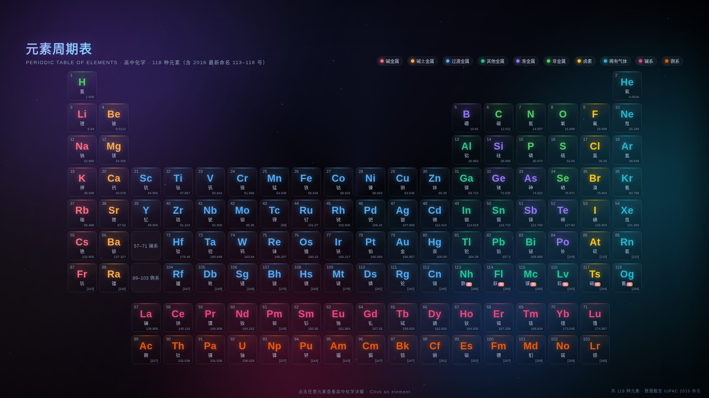

# 元素周期表 · 高中化学 动态壁纸

一款用于 **Wallpaper Engine** 的 Windows 网页动态壁纸：深空极光背景上的 118 元素周期表，点击任意元素弹出高中化学详解。

**在线地址：** <https://diyichongdi.github.io/2/>



## 特点

- **最新周期表**：收录 1–118 号全部元素，113–118 号采用 IUPAC 2016 年正式命名（Nh 鿭、Fl 鈇、Mc 镆、Lv 鉝、Ts 鿬、Og 鿫），并标注「新」。
- **高中化学详解**：点击元素展示原子序数、相对原子质量、周期/族、元素分区、常见化合价、常温状态、电子排布式与电子层排布、熔点/沸点/密度/电负性，以及针对高考与高中教材整理的知识要点与主要用途。
- **视觉**：深色星空 + 多层极光 + 缓慢旋转光晕 + 星点闪烁 + 对角扫光；元素按 10 大类着色，鼠标悬停高亮、选中描边。
- **单文件自包含**：`index.html` 内联全部 CSS / JS / 元素数据，无任何外部依赖，断网也能渲染（首次加载后）。

## 在 Wallpaper Engine 中使用

### 方式 A：从网址导入（推荐）

1. 打开 Wallpaper Engine，进入「已安装」或浏览壁纸界面。
2. 点击右下角 **打开 / Open**，选择 **从 URL 打开 / Open from URL**。
3. 粘贴本项目的 GitHub Pages 地址：`https://diyichongdi.github.io/2/`。
4. 输入名称，确定。首次加载需要联网。

> 若点击元素没有反应，请在壁纸属性中确认 **鼠标交互 / Mouse Input** 已开启（部分版本默认关闭）。

### 方式 B：本地工程导入

1. 下载 `index.html`、`project.json`、`preview.jpg` 到同一个文件夹。
2. 打开 Wallpaper Engine 编辑器，把 `index.html` 直接拖到 **创建壁纸 / Create Wallpaper** 上。
3. 壁纸会复制到 `wallpaper_engine\projects\myprojects\` 下，可继续在编辑器中修改。

## 文件结构

| 文件 | 说明 |
| --- | --- |
| `index.html` | 壁纸本体（单文件，内联全部样式、脚本与 118 元素数据） |
| `project.json` | Wallpaper Engine 工程描述（type=web） |
| `preview.jpg` | 1920×1080 预览图 |
| `preview-detail.jpg` | 元素详情面板预览 |
| `data.py` | 118 元素数据源（含高中化学要点） |
| `build.py` | 生成 `index.html` 与 `project.json` 的构建脚本 |
| `verify.py` / `measure.py` | 基于 Playwright 的渲染与布局自检脚本 |

## 重新生成

```bash
python3 build.py
```

修改 `data.py` 中的元素信息后重新构建即可；`build.py` 会校验 118 个元素、原子序数唯一性与关键字段完整性。

## 数据说明

相对原子质量、熔沸点、密度、电负性等取自常用教学数据，超重元素（104 号以后）多为受控合成，部分物性为预测值或缺失，表中以「—」显示。高中化学要点按人教版教材与高考常见考点整理，仅供学习参考。
